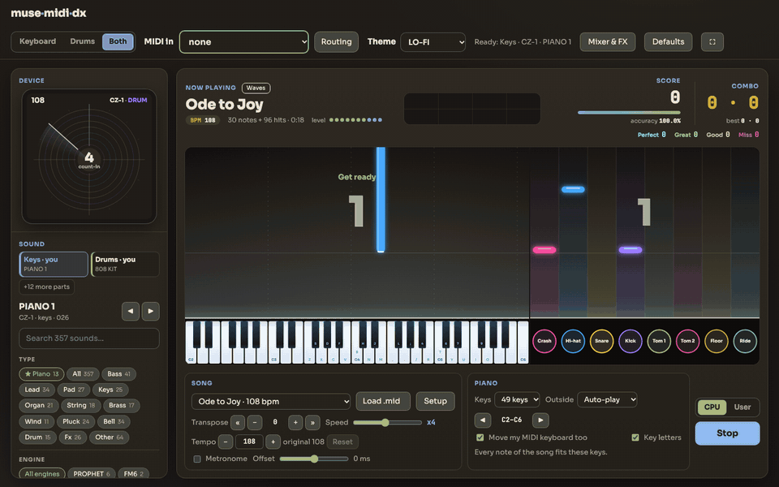

# muse-midi-dx

Rhythm game with your MIDI controller right from your browser.

**▶ Play it: [shan-sherif.github.io/muse-midi-dx](https://shan-sherif.github.io/muse-midi-dx/)** (Chrome or Edge for a
MIDI keyboard or drum kit)

[](https://shan-sherif.github.io/muse-midi-dx/)

Notes fall towards a piano keyboard, a drum kit, or both, and you play them on a MIDI keyboard, an e-drum kit, the
computer keyboard or the screen. Every press is judged PERFECT (±50 ms), GREAT (±100 ms), GOOD (±150 ms) or MISS.

The sound comes from a modified build of [Melodee](https://github.com/keremimo/melodee), synthesizer firmware for the
M-VAVE FM-1 and a fork of [Felucca](https://github.com/hugelton/Felucca), compiled to WebAssembly and running in the
browser. No FM-1 is needed. The game's build has fourteen parts, a four-slot effects rack and the parts' signals for
the waves (see [Our changes to Melodee](#our-changes-to-melodee)). Melodee's own engines (PROPHET, FM6, CZ-1, SID and
DRUM), presets and effects are joined by engines from two other FM-1 firmware projects: the TB-303 bass from
[fm1-x0x](https://github.com/charlesvestal/fm1-x0x) and the analog synth from
[sloop-fm1](https://github.com/isod89/sloop-fm1) ([engines/README.md](engines/README.md)). The screens (the chord wheel,
the rhythm ring, the waves) are drawn by the page.

## Playing

### Getting started

1. Open the page and pick what you play: **Keyboard**, **Drums** or **Both**.
2. Connect your MIDI device and choose it in **MIDI in** at the top. No device? Use the computer keys, or click the
   keys and pads on screen.
3. Press **OK, switch on**, pick a song, and press **Play** (or `Space`). `Esc` stops.

Web MIDI needs Chrome or Edge (or Firefox with Web MIDI enabled), and a page served from `https` or `localhost`.

### Instruments and parts

The device has fourteen parts, one per MIDI channel:

| Part / channel | Plays | Power-on sound |
| --- | --- | --- |
| 1 | **Keys**: you, in Keyboard or Both | CZ-1 PIANO 1 |
| 2 | **Drums**: you, in Drums or Both | 808 KIT |
| 3–14 | **Instrument 1–12**: the rest of a MIDI file, played by the device | FM6 SOLID BASS, CZ-1 SYNTH.LEAD 1, Prophet, FM6 STRINGS … |

Whichever of keys or drums you are not playing, the device plays. When a MIDI file is loaded, the instrument parts take
the names of the file's instruments ("Finger Bass", "Alto Sax" …) and, with **Match sounds** on, a sound like them
(see Setup below). The **Sound** tabs, the mixer and Setup's sounds show only the parts the song uses; **+N more parts**
shows all fourteen.

- **Keyboard:** a falling-note piano. Blue notes are white keys, yellow notes are black keys.
- **Drums:** eight lanes (Crash, Hi-hat, Snare, Kick, Tom 1, Tom 2, Floor, Ride), each in its kit colour.
  General MIDI drum notes are grouped into them; open, closed and pedal hi-hat all count as Hi-hat, for example. The
  kit's other sounds (tambourine, cowbell, claps, shakers, congas …) have no lane: the device plays them, unscored.
- **Both:** the piano and the drums side by side, with a combined score and a combo for each.

### Input

- **MIDI keyboard / e-drum kit:** choose it in **MIDI in**. A keyboard always plays part 1, whatever channel it sends on.
- **Two devices** (a keyboard and a drum kit): open **Routing** at the top. Each device shows its live signal (press
  a key or hit a pad, and its row lights up with the channel and note). Set it to **Keyboard**, **Drums**,
  **Split** (channel 10 to the drums, the rest to the keyboard) or **Off**. Choices are kept per device.
- **Computer keyboard:** Keyboard mode uses Melodee's tracker layout (`Z`…`/` from F3, `Q`/`4`…`O` above). Drums mode
  uses `A S D F J K L ;` for the eight pads.
- **Screen:** click or tap the piano keys under the notes, or the drum pads.

### Songs

- **Built-in:** a C major warm-up, Twinkle Twinkle, Ode to Joy, Minuet in G and the opening of Für Elise. All are
  public-domain melodies, transcribed for this project, each with a generic drum beat for Drums mode.
- **Load .mid:** any Standard MIDI File (type 0 or 1). The title comes from the file name. Tempo changes and time
  signatures are followed, and silence before the first note is trimmed in whole bars.
- **Setup** (opens after loading a file):
  - **Section:** a piano roll of the whole song. Drag the start and end handles (they snap to beats) to play a part
    of it.
  - **Who plays what:** each instrument in the file, with ▶ to hear it alone, its channel, notes and range. Set each
    to **You · keys**, **You · drums**, **Instrument 1–12** or **Leave out**. The picks start automatically: piano
    yours, the drum kit yours, a bass on Instrument 1, the busiest of the rest on 2–12. A song with more instruments
    than that puts the extra ones on a part with an instrument of their family (strings with strings …), or leaves
    them out.
  - **Duplicates:** an instrument whose notes are mostly another's (80% or more of them at the same pitch and time) is
    marked **same notes as …** and left out at first. These are doublings, such as a line written on two tracks. Set
    it to a part to hear it anyway.
  - **Match sounds** (on by default): each instrument part gets the sound nearest its General MIDI instrument. For
    example, Finger Bass gets CZ-1 ELEC.BASS 1, Alto Sax gets CZ-1 SAXOPHONE and Warm Pad gets ANALOG WARM PAD
    (`web/gmsounds.js`, one choice for each of the 128). A sound you choose for a part yourself (here or in the
    Sound tabs) stays with that song. Keys and Drums keep yours.
  - **Sounds** for the instrument parts.
- **Transpose:** move the song up or down by semitones (« » a whole octave), ±24. Drums are not transposed.
- **Tempo:** play the song slower or faster: − / + by 1 BPM, or type a BPM (25% to 200% of the song's own). The
  original stays shown beside it, and **Reset** puts it back. Everything follows: the notes, the band, the metronome
  and the device's BPM; pitch stays the same. Kept per song until the page is reloaded.
- **CPU / User:** CPU (the default) plays your part for you; User leaves it to you. You can switch mid-song.

### The Piano box

- **Keys:** the keyboard on screen: 25, 37, **49** (default), 61 or 73 keys, each at its usual range.
- **◀ ▶:** move it by octaves. **Move my MIDI keyboard too** transposes your MIDI keyboard with it, so its keys hit
  the notes on screen. Leave your controller's own octave buttons at their default.
- **Outside:** what happens to your notes outside those keys:
  - **Auto-play** (default): the device plays them, unscored. They show faintly at the edge.
  - **Fold in:** they are moved by octaves onto your keys and scored. Two notes landing on the same key at once are
    one press.
  - **Score them:** left as they are; unreachable ones are misses.
- **Key letters:** show the computer keys on the piano.

### The Song and Drums boxes

- **Speed:** x0.5 to x16. At x1 a note takes 4 s from the top to the hit line; the default is **x4**.
- **Metronome:** clicks on each beat (off by default), following the song's tempo map.
- **Offset:** shifts the judging by up to ±150 ms if hits feel early or late on your setup.
- **Drums box** (Drums only): the drum screen's **width**, 30–100% (55% by default).

### Sound, mixer and effects

- **Sound** (left): a tab per part. Each tab glows while its part is sounding. Search all 357 factory presets, or
  filter them by type and engine; ◀ ▶ step through the list. Choosing a sound plays a short C4 with it. The engines are
  Melodee's PROPHET, FM6, CZ-1, SID and DRUM, plus **X0X 303** (x0x's TB-303 bass: accent at velocity 100+, a note
  held into the next slides) and **ANALOG** (SLOOP's analog synth and preset bank).
- **Mixer & FX** (top): per part **level, pan, FX send, mute and solo**, a **master volume**, and the device's shared
  **effects rack** with four slots. Each slot takes Room, Reverb, Width, Phaser, Chorus, Flanger, Pedal phaser/chorus,
  Drive (soft, hard, fold, fuzz), Crush, Formant, Tape or Spit, with Mix, Rate, Character and, for Room and Reverb,
  Tone. **Chain** runs the slots in a row from one send; **Split** gives every part a send to each slot. There is one
  Reverb at most.

### The device screen

The screen top left is drawn by the page, and shows what you are playing. All three views show the tempo top left and
the engine playing top right (as the device's screen does). **Advanced: device controls** (the left column) shows
Melodee's own screen instead while it is open, for its buttons and knobs.

**Keyboard: the chord wheel** (`web/wheel.js`). The twelve notes round a circle of fifths. The notes you hold light up,
joined into the chord's shape, and the centre names them: a chord ("C", "Am", "G7", "C/E" …) or a note ("D4"). The
song's next notes show as rings closing in on theirs, and their name waits in the centre ("next") while you hold
nothing. Along the bottom, the keys on screen: what you hold lit (in its rating's colour as it is judged), the next
notes marked.

**Drums: the rhythm ring** (`web/ring.js`). One turn is one bar, with a hand sweeping round in time.
- Each drum is a ring in its kit colour, a drum staff read from the bottom up: **Kick** outermost, then Snare, the toms
  (Tom 1, Tom 2 and Floor share one ring, each hit in its own colour), Ride, Hi-hat, and **Crash** innermost.
- The song's hits for the bar are hollow dots (red once missed). Your hits are filled dots where they landed, so an
  early or late hit shows against its target.
- Last bar's dots fade as the hand comes round, so the groove reads as a pattern: four kicks evenly spaced round the
  outside, hats in between.
- The centre shows the beat, with the bar under it. With no song playing, the hand keeps time at the song's tempo for
  free play.
- Top right: the drum part's engine, in the kick's colour.

**Both: the ring plus a Keys ring.** The same ring, with one more ring outside the kick for the keys, in white (the
theme's text colour, so it is never taken for a drum). The song's piano notes for the bar are hollow dots (a chord as
one), your key presses filled dots, so your hands and feet show against each other in the bar. While you hold keys, the
centre names them (a chord, else the note), with the beat and bar under it. Top right: both engines, Keys then Drums
("CZ-1 · DRUM"), each in its colour.

The drum colours are fixed, as drum games colour a kit: Crash pink, Hi-hat blue, Ride teal, Snare yellow, Kick violet,
Tom 1 green, Tom 2 red, Floor orange. The drum highway's lanes and pads use the same ones.

### Waves

In the middle of the header, between the song's title and the score: the wave of every part that is sounding,
overlaid, each in its part's colour (the same colour as its Sound tab, which glows with it). They are the parts' real
signals, after their level, mute and solo and before pan and the effects. Each is drawn from a rising zero crossing,
so a held note stands still as on an oscilloscope, and all share one scale that follows the loudest. The **Waves**
button next to "Now playing" hides them (on by default, kept). On a narrow window they get a row of their own under the
title.

### Themes and settings

- **Theme** (top): the device screen's palette. The whole page takes its colours from it: NIGHT, DAY, CONTRAST,
  SUNSET, OCEAN, NEON, CANDY or **LO-FI** (default). Changing it on the device does the same.
- **Kept in this browser:** the theme, every part's sound, the mix and effects, the instrument (Keyboard, Drums,
  Both), MIDI routing, keys, octave, Outside, speed, offset, metronome, key letters, the drum screen's width, Waves and
  Match sounds.
  Songs and their setup are kept until the page is reloaded.
- **Defaults** (top, click twice): puts all of it back.
- **⛶:** full screen.

### Free play and results

With no song running, the notes are hidden and every key you press lights its column (on the drums, its lane). After
a song: the grade (S, A, B, C, D), a row per rating with its notes and share, max combo, accuracy and score, then
**Play again** or **Free play**.

## Run locally

The built firmware (`web/melodee.wasm`) is committed, so playing needs only Node:

```sh
npm run dev                                     # http://localhost:8000
```

`PORT=8123 npm run dev` uses another port.

### Rebuilding the firmware

Only needed after changing `emu/`, `patches/` or `scripts/gen_palettes.py`, or to run the sanitizer check:

```sh
git submodule update --init                     # vendor/melodee (v1.6.1, as upstream has it)
python3 -m venv .venv && .venv/bin/pip install Pillow fonttools
source ~/emsdk/emsdk_env.sh                     # Emscripten (emcc)
npm run build:emu                               # patches Melodee, builds web/melodee.wasm: commit it
npm run check:native                            # the sanitizer check (see Checks)
```

## Project layout

| Path | What |
| --- | --- |
| `vendor/melodee/` | Melodee, the upstream submodule (untouched) |
| `patches/` | changes to Melodee, applied in order at build time |
| `engines/` | engines from other projects, a folder a source ([engines/README.md](engines/README.md)) |
| `scripts/gen_ext_engines.py` | finds the sources in `engines/`, checks their ids and licences, writes their tables |
| `.github/workflows/pages.yml` | publishes `web/` to GitHub Pages |
| `emu/game_glue.c` | Melodee's browser glue (`web/emu/melodee_web.c`) plus the game's exports: held notes, presets per part, the mixer and rack, palettes, BPM, part count and activity, the parts' waves, `game_init` (no DRUM channel) |
| `emu/native_check.c`, `.sh` | the sanitizer check of the patched firmware |
| `scripts/build-emu.sh` | copies Melodee to `.build/melodee`, applies the patches, generates its headers, builds `web/melodee.wasm` and `web/version.json` (Melodee's version, the part count) |
| `scripts/gen_palettes.py` | the device's palettes with the track colours reversed |
| `scripts/serve.mjs` | a small static server for `web/` |
| `web/index.html`, `style.css` | the page |
| `web/app.js` | the screens (which shows), sounds and Match sounds, mixer, themes, MIDI and routing, songs and setup (duplicates, who plays what), the waves, scheduling, settings |
| `web/game.js` | the piano highway: drawing, judging, scoring |
| `web/drums.js` | the drum highway |
| `web/worklet.js` | the firmware in an AudioWorklet: audio, Melodee's screen, held notes, timed MIDI, presets, mixer, the parts' waves |
| `web/songs.js` | the built-in songs and their generated beats |
| `web/midifile.js` | `.mid` → a chart, its instruments kept apart |
| `web/gmsounds.js` | each General MIDI instrument's nearest sound (Match sounds) |
| `web/ring.js` | the rhythm ring (Drums and Both, in the device screen's place) and the chord names |
| `web/wheel.js` | the chord wheel (Keyboard, in the device screen's place) |
| `docs/media/gameplay.gif` | the README's recording: Ode to Joy on piano and drums (Both), CPU mode |

## Our changes to Melodee

The game no longer targets the FM-1, so it runs a modified Melodee. `vendor/melodee` stays the upstream submodule,
untouched. `scripts/build-emu.sh` copies it to `.build/melodee` and applies `patches/*.patch` there, in order, before
every build.

`patches/01-six-parts.patch`:

- **Six parts** (`NPART` 6, `NMIDI` 2, so there are still 8 tracks): MIDI channels 1–6 play parts 1–6. Part 1 is the
  keys, part 2 the drums, parts 3–6 the rest. (Patch 05 then makes them fourteen.)
- `NVIEW` 4: what one device screen shows at once (rows, knob cards, mute keys). The device's screens page through
  tracks 1–4 and 5–8, as before.
- The visualiser (HOME's chord view, and Stage) shows parts 1 and 2 only, the ones you play.
- A shared voice budget of 48 points by default (96 at most), and a 4× working-memory arena.
- The saved-project format keeps the FM-1's four parts (`PROJ_TRK` 4). Nothing is saved in the browser.
- A fix for the host build: its project caches had 4 slots while there are 32 projects, so opening project 5 or
  later read and wrote past them. This was in upstream too.

`patches/02-four-fx-slots.patch`:

- **A fourth slot in the shared effects rack** (`RACK_SLOTS` 4). Every rack setting followed the last, so slot 4's
  settings live in their own table (`rack4[]`). Each part's send to it reuses a retired setting ID (`P_RESERVED45`,
  now `P_FXSEND4`), so no other setting moves. It works like slots 1–3. The device's own rack screen and the saved
  format keep three.

`patches/03-engine-slots.patch`:

- **Room for engines from other projects**: engine ids 22–31 (`NENGINES` 32), filled from `engines/` by
  `scripts/gen_ext_engines.py`, each source in its own folder ([engines/README.md](engines/README.md)). An id no source
  takes is never offered. Two hooks: the sources' power-on (`web_boot`) and their presets' extras (`apply_preset_to`).

`patches/04-fixes.patch`, two fixes to upstream Melodee, found by the sanitizer check:

- **Melodee's DRUM engine**: rendering a voice, it decided which kit it plays from the track as it is now and
  from the block's parameters as they were queued. When the kit changed in between, the two disagreed: the 909 read its
  sound table with another kit's sound number (60, where it has 16), or a lane that does not exist was used. It now
  decides from the block's parameters throughout, and a sound number out of range plays nothing. It shows once engines
  are switched on parts at random; the new engines are not involved.
- **Undoing a sound load on a MIDI-only track** (tracks 7–8 here, 5–8 on the FM-1) wrote its Prophet patch past
  Melodee's table, which has an entry per synth part only. Only synth parts swap it now.

`patches/05-fourteen-parts.patch`:

- **Fourteen parts** (`NPART` 14, `NMIDI` 1: 15 tracks). This is the most there can be, because a held note keeps its
  track's number in four bits. MIDI channels 1–14 play parts 1–14, and the voice budget is 112 points by default
  (224 at most).
- Pattern banks: 8 a track (`NPAT` 8; tracks × banks must fit in 128). The saved pattern-bank format keeps its 8 tracks.
- The masks that hold one bit a track are 32-bit where a part past 8 can set its bit: panic, the MIDI targets, and
  the Song sounds. Melodee's own sequencer recording and motion keep their 8-bit masks, so parts 9–14 do not record
  into the device's sequencer. The game does not use it.
- Two bugs that appear past 8 tracks, found by the sanitizer check. Bank serialisation wrote past its tables for
  tracks past the saved four. Loading a project turned parts 5 and up into MIDI tracks.
- The device's screens: track keys exist for the first 8 parts only. Screens that show four tracks at a time end
  their last group at the last track (12–15 would be past it).

`patches/06-part-scope.patch`:

- **The wave screen's signal.** Each part's last 2,048 samples as it goes into the mix (`part_scope`, 16-bit), and
  zeros for a part that is silent in a block. `emu/game_glue.c` exposes it (`game_scope_ptr`, `_len`, `_pos`); the
  worklet sends the sounding parts' last 1,024 samples in its frames while the Waves screen is shown. Melodee's own
  master scope (`audio.c`, `SCOPE_N`) is a different buffer. The names differ (`PART_SCOPE_N`) because the build
  hides warnings, so a redefined macro passes silently.

`patches/07-screen-switch.patch`:

- **Melodee's screen drawn only when it is shown.** The page draws its own screens and shows Melodee's only while
  **Advanced** is open; the rest of the time a frame runs the LEDs alone (the buttons stay live), with no `ui_draw` and
  no compare of the 115 KB frame, so no frame goes to the page either. On again, it is drawn whole. `emu/game_glue.c`:
  `game_screen`.

The glue (`emu/game_glue.c`, `game_init`) also turns off Melodee's DRUM channel setting, which sends channel 10 to
the drum part. The page routes every note to its part itself, so channel 10 is Instrument 8's.

Built alongside, without patching Melodee's source: its palettes with the track colours reversed
(`scripts/gen_palettes.py`).

## Checks

`npm run check:native` builds the patched firmware natively with AddressSanitizer and UndefinedBehaviorSanitizer. It
plays all fourteen parts, sets their mix, selects every track, presses every button and knob, puts every effect in every
rack slot (Chain and Split), every preset of every engine from `engines/` on every part, then runs 20,000 random
inputs, engines switched on parts and Melodee's screen switched off and on among them. `NATIVE_SEED=n` gives another
random run, `NATIVE_TRACE=1` prints each input. The alignment and shift checks are off: the host harness removes every
`__attribute__`, and the DSP code shifts negative values on purpose, both upstream as here.

### Performance

Measured on the WebAssembly build (Node, Apple silicon), audio CPU as a share of real time; an audio block has 2.9 ms:

| Case | CPU | Slowest block |
| --- | --- | --- |
| A 16-instrument song on all 14 parts, matched sounds | 3.1% | 0.27 ms |
| Stress: all 14 parts playing 4-note chords, non-stop | 8.1% | 0.40 ms |
| Nothing playing | 0.5% | 0.04 ms |

## To do

- [ ] **A help page for MIDI**, separate from the game: how to connect a MIDI keyboard or e-drum kit, choose it in
  **MIDI in**, route two devices in **Routing**, load a `.mid` file, and use **Setup** (choosing a section, who plays
  what, the instruments' sounds). Link it from the game's page.
- [ ] **A screen for the device's settings**, separate from the game. The device's own screens (GLO, the rack, …)
  are not used; the page draws the screen (the chord wheel, the rhythm ring), Melodee's only under **Advanced**.
- [ ] **Remove the device's unused screens** (sequencer, mixer, song …) from the build. Everything is set on the
  page. Until then they still work under **Advanced**, at 14 parts too (memory-safe, but laid out for 8).
- [ ] **More sound engines** (possibly). Engines from other projects plug in as folders in `engines/` (so far x0x's 303
  and SLOOP's ANALOG). Melodee keeps more of its own that are retired or turned off in its build (e.g. PHASE, VOICE,
  TRIO, WHEEL, NOISE, behind `MELODEE_LEGACY_EXTRAS`).

## About this project

I started this project to combine the emulated hardware from the MVAVE FM-1 development scene into a music player concept, which doubles as a rhythm game. Having played several rhythm games in the past (e.g. [DTXMania](https://osdn.net/projects/dtxmania) (yyagi) [DTXMania2](https://dtxmania.net) [[Github](https://github.com/DTXMania)]), I wanted to develop one which you can use midi directly instead of simfiles (primary unit of game content for music game simulators).

Muse-Midi-DX was written with the help of Claude Opus 5.5, an AI model by Anthropic,
and the result was checked manually.

## Privacy

The page counts visits with [GoatCounter](https://www.goatcounter.com/) (no cookies, no personal data). Settings
are saved only in your own browser.

## Licence

Copyright (C) 2026 shan-sherif

This program is free software: you can redistribute it and/or modify it under the terms of the GNU General Public
License as published by the Free Software Foundation, version 3 ([LICENSE](LICENSE)). It is distributed in the hope that
it will be useful, but WITHOUT ANY WARRANTY; without even the implied warranty of MERCHANTABILITY or FITNESS FOR A
PARTICULAR PURPOSE.

The game is GPL-3.0 because `web/melodee.wasm` and `emu/game_glue.c` are built from
[Melodee](https://github.com/keremimo/melodee) (GPL-3.0-only, Kerem Kilic / Ellic Studio; portions from
[Felucca](https://github.com/hugelton/Felucca), Leo Kuroshita, Hügelton Instruments), modified as described above. A
public deployment must offer its corresponding source, for example by linking to this repository. The built-in songs
are public-domain melodies.

The engines in `engines/` come from [x0x](https://github.com/charlesvestal/fm1-x0x) (Charles Vestal) and
[SLOOP](https://github.com/isod89/sloop-fm1) (isod89), both GPL-3.0 forks of Felucca. x0x's 303 contains parts of
[Open303](https://github.com/RobinSchmidt/Open303) by Robin Schmidt under the MIT licence
(`engines/x0x/LICENSE-MIT-Open303.txt`). Each folder's `NOTICE.md` gives the details. TB-303 is a trademark of Roland
Corporation, used only to describe what the engine emulates.

M-VAVE and FM-1 are trademarks of their respective owners; this project is not affiliated with them, Melodee or
Hügelton Instruments.
