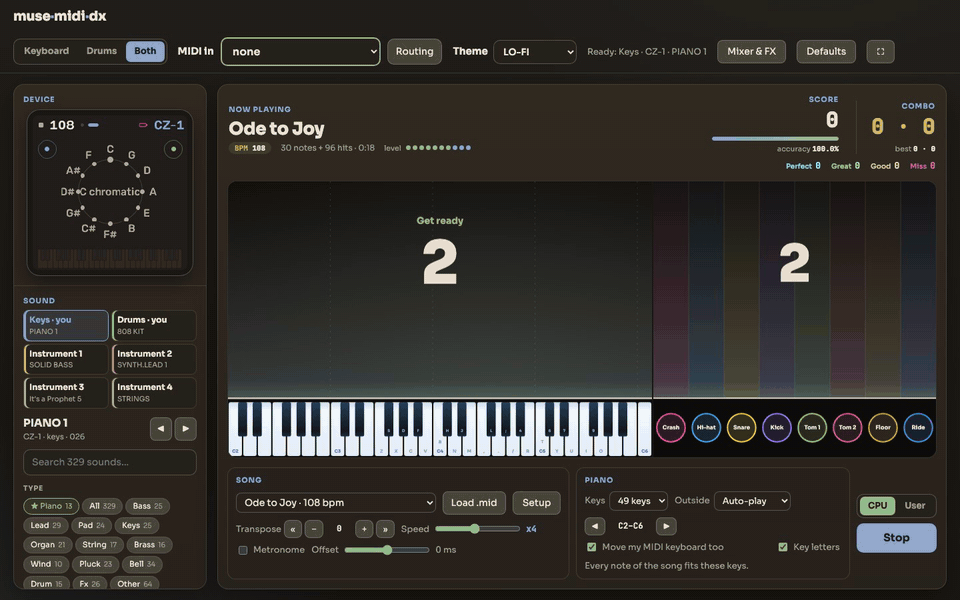

# muse-midi-dx

Rhythm game with your MIDI controller right from your browser.

**▶ Play it: [shan-sherif.github.io/muse-midi-dx](https://shan-sherif.github.io/muse-midi-dx/)** (Chrome or Edge for a
MIDI keyboard or drum kit)

[](https://shan-sherif.github.io/muse-midi-dx/)

Notes fall towards a piano keyboard, a drum kit, or both, and you play them on a MIDI keyboard, an e-drum kit, the
computer keyboard or the screen. Every press is judged PERFECT (±50 ms), GREAT (±100 ms), GOOD (±150 ms) or MISS.

The sound comes from [Melodee](https://github.com/keremimo/melodee), synthesizer firmware for the M-VAVE FM-1 and a
fork of [Felucca](https://github.com/hugelton/Felucca). It is compiled to WebAssembly and runs in the browser, so the
engines, presets and effects are the firmware's own. No FM-1 is needed. The game runs a modified Melodee: six parts
and a four-slot effects rack (see [Our changes to Melodee](#our-changes-to-melodee)).

## Playing

### Getting started

1. Open the page and pick what you play: **Keyboard**, **Drums** or **Both**.
2. Connect your MIDI device and choose it in **MIDI in** at the top. No device? Use the computer keys, or click the
   keys and pads on screen.
3. Press **OK, switch on**, pick a song, and press **Play** (or `Space`). `Esc` stops.

Web MIDI needs Chrome or Edge (or Firefox with Web MIDI enabled), and a page served from `https` or `localhost`.

### Instruments and parts

The device has six parts, one per MIDI channel:

| Part / channel | Plays | Power-on sound |
| --- | --- | --- |
| 1 | **Keys**: you, in Keyboard or Both | CZ-1 PIANO 1 |
| 2 | **Drums**: you, in Drums or Both | 808 KIT |
| 3–6 | **Instrument 1–4**: the rest of a MIDI file, played by the device | FM6 SOLID BASS, CZ-1 SYNTH.LEAD 1, Prophet, FM6 STRINGS |

Whichever of keys or drums you are not playing, the device plays. When a MIDI file is loaded, Instruments 1–4 take
the names of the file's instruments ("Finger Bass", "Alto Sax" …) to help with the selection of instruments from the engine to play.

- **Keyboard:** a falling-note piano. Blue notes are white keys, yellow notes are black keys.
- **Drums:** eight lanes (Crash, Hi-hat, Snare, Kick, Tom 1, Tom 2, Floor, Ride), each in its kit colour.
  General MIDI drum notes are grouped into them; open, closed and pedal hi-hat all count as Hi-hat, for example.
- **Both:** the piano and the drums side by side, with a combined score and a combo for each.

### Input

- **MIDI keyboard / e-drum kit:** choose it in **MIDI in**. A keyboard always plays part 1, whatever channel it sends on.
- **Two devices** (a keyboard and a drum kit): open **Routing** at the top. Each device shows its live signal (press
  a key or hit a pad, and its row lights up with the channel and note). Set it to **Keyboard**, **Drums**,
  **Split** (channel 10 to the drums, the rest to the keyboard) or **Off**. Choices are kept per device.
- **Computer keyboard:** Keyboard mode uses Melodee's tracker layout (`Z`…`/` from F3, `Q`/`4`…`O` above). Drums mode
  uses `A S D F J K L ;` for the eight pads.
- **Screen:** click or tap the piano keys under the notes, or the drum pads.

### Songs

- **Built-in:** a C major warm-up, Twinkle Twinkle, Ode to Joy, Minuet in G and the opening of Für Elise. All are
  public-domain melodies, transcribed for this project, each with a generic drum beat for Drums mode.
- **Load .mid:** any Standard MIDI File (type 0 or 1). The title comes from the file name. Tempo changes and time
  signatures are followed, and silence before the first note is trimmed in whole bars.
- **Setup** (opens after loading a file):
  - **Section:** a piano roll of the whole song. Drag the start and end handles (they snap to beats) to play a part
    of it.
  - **Who plays what:** each instrument in the file, with ▶ to hear it alone, its channel, notes and range. Set each
    to **You · keys**, **You · drums**, **Instrument 1–4** or **Leave out**. The picks start automatically: piano
    yours, the drum kit yours, a bass on Instrument 1, the busiest of the rest on 2–4.
  - **Sounds** for Instruments 1–4.
- **Transpose:** move the song up or down by semitones (« » a whole octave), ±24. Drums are not transposed.
- **CPU / User:** CPU (the default) plays your part for you; User leaves it to you. You can switch mid-song.

### The Piano box

- **Keys:** the keyboard on screen: 25, 37, **49** (default), 61 or 73 keys, each at its usual range.
- **◀ ▶:** move it by octaves. **Move my MIDI keyboard too** transposes your MIDI keyboard with it, so its keys hit
  the notes on screen. Leave your controller's own octave buttons at their default.
- **Outside:** what happens to your notes outside those keys:
  - **Auto-play** (default): the device plays them, unscored. They show faintly at the edge.
  - **Fold in:** they are moved by octaves onto your keys and scored. Two notes landing on the same key at once are
    one press.
  - **Score them:** left as they are; unreachable ones are misses.
- **Key letters:** show the computer keys on the piano.

### The Song and Drums boxes

- **Speed:** x0.5 to x16. At x1 a note takes 4 s from the top to the hit line; the default is **x4**.
- **Metronome:** clicks on each beat (off by default), following the song's tempo map.
- **Offset:** shifts the judging by up to ±150 ms if hits feel early or late on your setup.
- **Drums box** (Drums only): the drum screen's **width**, 30–100% (55% by default).

### Sound, mixer and effects

- **Sound** (left): a tab per part. Each tab glows while its part is sounding. Search all 329 factory presets, or
  filter them by type and engine; ◀ ▶ step through the list.
- **Mixer & FX** (top): per part **level, pan, FX send, mute and solo**, a **master volume**, and the device's shared
  **effects rack** with four slots. Each slot takes Room, Reverb, Width, Phaser, Chorus, Flanger, Pedal phaser/chorus,
  Drive (soft, hard, fold, fuzz), Crush, Formant, Tape or Spit, with Mix, Rate, Character and, for Room and Reverb,
  Tone. **Chain** runs the slots in a row from one send; **Split** gives every part a send to each slot. There is one
  Reverb at most.

### The device screen

The FM-1's own 240×240 screen, top left, shows the chord view: the notes of parts 1 and 2 on a wheel of fifths, the
chord's name, and a keyboard. It also shows the song's BPM. The device's own controls are under **Advanced** in the
left column.

### Themes and settings

- **Theme** (top): the device screen's palette. The whole page takes its colours from it: NIGHT, DAY, CONTRAST,
  SUNSET, OCEAN, NEON, CANDY or **LO-FI** (default). Changing it on the device does the same.
- **Kept in this browser:** the theme, every part's sound, the mix and effects, the instrument (Keyboard, Drums,
  Both), MIDI routing, keys, octave, Outside, speed, offset, metronome, key letters and the drum screen's width.
  Songs and their setup are kept until the page is reloaded.
- **Defaults** (top, click twice): puts all of it back.
- **⛶:** full screen.

### Free play and results

With no song running, the notes are hidden and every key you press lights its column (on the drums, its lane). After
a song: the grade (S, A, B, C, D), a row per rating with its notes and share, max combo, accuracy and score, then
**Play again** or **Free play**.

## Run locally

The built firmware (`web/melodee.wasm`) is committed, so playing needs only Node:

```sh
npm run dev                                     # http://localhost:8000
```

`PORT=8123 npm run dev` uses another port.

### Rebuilding the firmware

Only needed after changing `emu/`, `patches/` or `scripts/gen_palettes.py`, or to run the sanitizer check:

```sh
git submodule update --init                     # vendor/melodee (v1.6.1, as upstream has it)
python3 -m venv .venv && .venv/bin/pip install Pillow fonttools
source ~/emsdk/emsdk_env.sh                     # Emscripten (emcc)
npm run build:emu                               # patches Melodee, builds web/melodee.wasm: commit it
npm run check:native                            # the sanitizer check (see Checks)
```

## Project layout

| Path | What |
| --- | --- |
| `vendor/melodee/` | Melodee, the upstream submodule (untouched) |
| `patches/` | changes to Melodee, applied in order at build time |
| `.github/workflows/pages.yml` | publishes `web/` to GitHub Pages |
| `emu/game_glue.c` | Melodee's browser glue (`web/emu/melodee_web.c`) plus the game's exports: held notes, presets per part, the mixer and rack, palettes, BPM, part activity |
| `emu/native_check.c`, `.sh` | the sanitizer check of the patched firmware |
| `scripts/build-emu.sh` | copies Melodee to `.build/melodee`, applies the patches, generates its headers, builds `web/melodee.wasm` |
| `scripts/gen_palettes.py` | the device's palettes with the track colours reversed |
| `scripts/serve.mjs` | a small static server for `web/` |
| `web/index.html`, `style.css` | the page |
| `web/app.js` | the device screen, sounds, mixer, themes, MIDI and routing, songs and setup, scheduling, settings |
| `web/game.js` | the piano highway: drawing, judging, scoring |
| `web/drums.js` | the drum highway |
| `web/worklet.js` | the firmware in an AudioWorklet: audio, the screen, held notes, timed MIDI, presets, mixer |
| `web/songs.js` | the built-in songs and their generated beats |
| `web/midifile.js` | `.mid` → a chart, its instruments kept apart |
| `docs/media/gameplay.gif` | the README's recording: Ode to Joy on piano and drums, CPU mode |

## Our changes to Melodee

The game no longer targets the FM-1, so it runs a modified Melodee. `vendor/melodee` stays the upstream submodule,
untouched. `scripts/build-emu.sh` copies it to `.build/melodee` and applies `patches/*.patch` there, in order, before
every build.

`patches/01-six-parts.patch`:

- **Six parts** (`NPART` 6, `NMIDI` 2, so there are still 8 tracks): MIDI channels 1–6 play parts 1–6. Part 1 is the
  keys, part 2 the drums, parts 3–6 the rest. The power-on sounds are as in the table above.
- `NVIEW` 4: what one device screen shows at once (rows, knob cards, mute keys). The device's screens page through
  tracks 1–4 and 5–8, as before.
- The visualiser (HOME's chord view, and Stage) shows parts 1 and 2 only, the ones you play.
- A shared voice budget of 48 points by default (96 at most), and a 4× working-memory arena.
- The saved-project format keeps the FM-1's four parts (`PROJ_TRK` 4). Nothing is saved in the browser.
- A fix for the host build: its project caches had 4 slots while there are 32 projects, so opening project 5 or
  later read and wrote past them. This was in upstream too.

`patches/02-four-fx-slots.patch`:

- **A fourth slot in the shared effects rack** (`RACK_SLOTS` 4). Every rack setting followed the last, so slot 4's
  settings live in their own table (`rack4[]`). Each part's send to it reuses a retired setting ID (`P_RESERVED45`,
  now `P_FXSEND4`), so no other setting moves. It works like slots 1–3. The device's own rack screen and the saved
  format keep three.

Built alongside, without patching Melodee's source: its palettes with the track colours reversed
(`scripts/gen_palettes.py`).

## Checks

`npm run check:native` builds the patched firmware natively with AddressSanitizer and UndefinedBehaviorSanitizer. It
plays all six parts, sets their mix, selects every track, presses every button and knob, puts every effect in every
rack slot (Chain and Split), then runs 20,000 random inputs. `NATIVE_SEED=n` gives another random run. The alignment
and shift checks are off: the host harness removes every `__attribute__`, and the DSP code shifts negative values on
purpose, both upstream as here.

## To do

- [ ] **A help page for MIDI**, separate from the game: how to connect a MIDI keyboard or e-drum kit, choose it in
  **MIDI in**, route two devices in **Routing**, load a `.mid` file, and use **Setup** (choosing a section, who plays
  what, the instruments' sounds). Link it from the game's page.
- [ ] **A screen for the device's settings**, separate from the game. The device's own screens (GLO, the rack, …)
  are not used; its screen is the visualiser only.

## About this project

I started this project to combine the emulated hardware from the MVAVE FM-1 development scene into a music player concept, which doubles as a rhythm game. Having played several rhythm games in the past (e.g. [DTXMania](https://osdn.net/projects/dtxmania) (yyagi) [DTXMania2](https://dtxmania.net) [[Github](https://github.com/DTXMania)]), I wanted to develop one which you can use midi directly instead of simfiles (primary unit of game content for music game simulators).

Muse-Midi-DX was written with the help of Claude Opus 5.5, an AI model by Anthropic,
and the result was checked manually.

## Licence

Copyright (C) 2026 shan-sherif

This program is free software: you can redistribute it and/or modify it under the terms of the GNU General Public
License as published by the Free Software Foundation, version 3 ([LICENSE](LICENSE)). It is distributed in the hope that
it will be useful, but WITHOUT ANY WARRANTY; without even the implied warranty of MERCHANTABILITY or FITNESS FOR A
PARTICULAR PURPOSE.

The game is GPL-3.0 because `web/melodee.wasm` and `emu/game_glue.c` are built from
[Melodee](https://github.com/keremimo/melodee) (GPL-3.0-only, Kerem Kilic / Ellic Studio; portions from
[Felucca](https://github.com/hugelton/Felucca), Leo Kuroshita, Hügelton Instruments), modified as described above. A
public deployment must offer its corresponding source, for example by linking to this repository. The built-in songs
are public-domain melodies.

M-VAVE and FM-1 are trademarks of their respective owners; this project is not affiliated with them, Melodee or
Hügelton Instruments.
